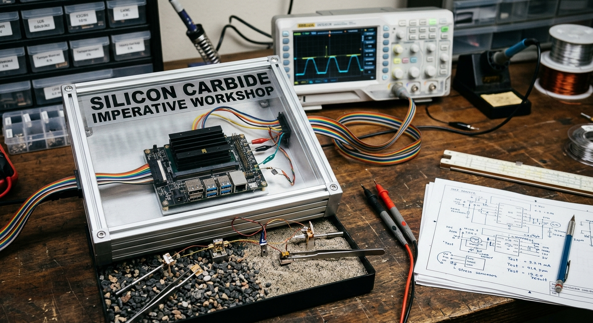

# Silicon Carbide Imperative Workshop



> **A public, accumulating record of pre-registered physical measurements that test first-principles models against real hardware.**

[](https://opensource.org/licenses/MIT)
[](https://scimperative.com/?view=workshop)

Part of the [Silicon Carbide Imperative](https://scimperative.com) — first-principles engineering, economics and geopolitics where machines meet physical reality.  
Companion to the [Sandbox](https://github.com/scimperative/sandbox) (checkable models) and the [Library](https://scimperative.com/?view=library) (an index of written research).

---

## Overview

**SC Imperative Workshop** is the irreversible measurement channel of the project.

Modern technical analysis is often limited by models that never leave the page, claims that are never pre-committed, and performance numbers that cannot be traced to a transparent protocol and raw data. The Workshop closes that loop.

Every run follows the same discipline:

1. **Pre-register** a prediction and uncertainty range (publicly timestamped before any measurement begins).
2. **Execute** an exact, documented protocol on accessible hardware.
3. **Publish** the original prediction, the protocol, the raw data, the measured outcome, the gap analysis, and a clear scope-and-transferability note.

The result is a growing, timestamped, publicly scored record of how often models and claims fall inside their stated uncertainty bands when tested against physical reality.

**Current status:** one completed run is published: [Workshop 01](01-hailo-expectation-calibration/README.md), a Raspberry Pi 5 and Hailo-8L measurement. Four numerical intervals hit (4/4); the categorical bottleneck prediction missed (0/1). The numerical predictions were pilot-informed, not blind forecasts, and five planned metrics remain unmeasured. See the run's scorecard for details.

**Current headline numbers:** 4/4 numerical intervals hit; 0/1 categorical predictions hit; mean absolute log10 error 0.005 across the scored numerical metrics. This is one pilot-informed run, not a broad calibration estimate.

See the [scorecard](01-hailo-expectation-calibration/results/scorecard.md) and [gap analysis](01-hailo-expectation-calibration/results/gap-analysis.md).

---

## Core Principles

1. **Prediction before measurement.** The prediction and uncertainty range are committed and timestamped before the protocol is executed. The record cannot be back-filled.
2. **Accessible hardware, transparent protocols.** Runs are performed on consumer and development platforms (currently ASUS TUF A14, Jetson-class, Raspberry Pi and similar). Every protocol is published so others can repeat or challenge it.
3. **Raw data is part of the record.** Measured values, intermediate logs and environmental notes travel with the run. Summaries alone are not enough.
4. **Scope and transferability are explicit.** Every run states what the measurement does and does not speak to. Calibration on accessible hardware is useful for teaching, reference and personal calibration; it is not certification-grade evidence for other regimes.
5. **The gap is the signal.** The difference between prediction and measurement (the reality gap) is the primary output. Systematic biases across runs are more valuable than any single result.
6. **Named accountability.** Every claim is backed by a named engineer who stands behind the protocol, the data and the analysis.

---

## Run Index

| Run | Title | Hardware | Status | Scored outcome |
| :--- | :--- | :--- | :--- | :--- |
| 01 | [Calibrating Expectations for Raspberry Pi 5 + Hailo AI HAT+](01-hailo-expectation-calibration/README.md) | Raspberry Pi 5 + Hailo-8L AI HAT+ | Complete for stated scope | 4/4 numerical intervals; 0/1 categorical predictions |

Runs will be numbered sequentially (`01-…`, `02-…`) and referred to publicly as **Workshop 01**, **Workshop 02**, etc.

---

## Repository Structure

```
workshop/
├── README.md
├── assets/
└── 01-hailo-expectation-calibration/
    ├── README.md
    ├── pre-registration/     # Frozen predictions and templates
    ├── protocol/             # Procedure, deviations, and addenda
    ├── data/                 # Raw measurements, logs, and manifests
    ├── results/              # Summary, scorecard, gap analysis, and figures
    └── scripts/              # Measurement and analysis tools
```

Each run is self-contained. New runs should follow the same evidence-first structure while documenting any deliberate deviations.

---

## Anatomy of a Run

A published run contains at minimum:

| Element | Purpose |
| :--- | :--- |
| **Pre-registered prediction** | Point estimate + uncertainty range, committed before measurement. Timestamped (commit, issue, or equivalent public record). |
| **Protocol** | Exact steps, equipment, software versions, environmental conditions, and any deliberate exclusions. |
| **Raw data** | Unprocessed measurements and logs. Prefer formats that preserve precision and provenance. |
| **Measured outcome** | The result of applying the protocol. |
| **Gap analysis** | Difference between prediction and measurement; discussion of possible sources of discrepancy. |
| **Scope & transferability note** | What the run does and does not claim; limits of generalisation to other hardware, environments or scales. |
| **Metadata** | Run identifier, dates, hardware identifiers, software versions, linked Sandbox module (if any), linked Library piece (if any). |

Where a corresponding Sandbox module exists, the run carries a link and the module may later display a “measured against hardware” badge pointing back here.

---

## Triggers for a Run

A measurement is worth doing when one or more of the following hold:

- A real decision or intuition is being shaped by an untested model or claim about physical limits.
- A public claim is being treated as more solid than the evidence warrants.
- A coherent family of questions is being deliberately densified so the accumulating record becomes a useful reference.
- Personal calibration is needed before further reasoning.

The primary audience is future-self, serious technical readers thinking about physical limits in AI hardware, space systems or edge compute, and independent analysts who prefer measurement over narrative. Mass reach is neither required nor expected.

---

## Relationship to the Other Pillars

| Pillar | Role |
| :--- | :--- |
| **Workshop** (this repository) | Produces the irreversible measurement record. |
| **Sandbox** | Makes the underlying models checkable and visible; later carries “measured against hardware” badges that link here. |
| **Library** | Indexes written research and links to original Substack articles, including pieces relevant to a measurement. |

Library entries link to the original articles; those articles may link to tools and runs. The measurement record is the primary compounding asset.

---

## Versioning and Reproducibility

- Each run is immutable once published. Corrections are issued as a new run or as a clearly marked erratum that points to the original.
- Predictions are never altered after the fact. If a prediction was wrong, the gap is recorded.
- Protocols and data remain available so that others can re-execute or re-analyse.
- When a run is linked to a Sandbox module, the module’s release version and the exact commit used for any model-side comparison are recorded in the run metadata.

---

## Contributing / Adding a Run

This repository is the public record maintained by the project. External contributions of independent measurements that follow the same discipline (pre-registration, transparent protocol, raw data, explicit scope) are welcome in principle and will be evaluated against the project’s rules (public sources only, no employer material, named-company caution, etc.).

For the project itself, a new run is created by:

1. Choosing a question that satisfies a trigger above.
2. Writing and publishing the prediction + uncertainty range before any measurement.
3. Executing the protocol on the chosen hardware.
4. Committing the full folder structure with raw data and analysis.
5. Updating the run index in this README and the public Workshop view on the main site.

---

## Licence

This project is licensed under the **MIT License**. See the [LICENSE](LICENSE) file for details.

Measurement data and protocols are released under the same licence unless a specific run states otherwise.

---

## Links

- Main site: [scimperative.com](https://scimperative.com)
- Workshop view: [scimperative.com/?view=workshop](https://scimperative.com/?view=workshop)
- Library view: [scimperative.com/?view=library](https://scimperative.com/?view=library)
- Sandbox: [github.com/scimperative/sandbox](https://github.com/scimperative/sandbox)
- Substack: [scimperative.substack.com](https://scimperative.substack.com)
- Organisation: [github.com/scimperative](https://github.com/scimperative)

---

*Silicon Carbide Imperative — finding the binding constraint where models meet real-world friction.*
